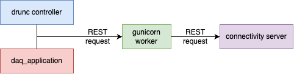

# Connectivity Service Architecture

## Overview

The Connectivity Service is a lightweight service that enables dynamic discovery and retrieval of network endpoints.



### Core Design Pattern

The service uses a publish-subscribe discovery model with time-to-live (TTL) expiration:
- Applications publish network endpoints to the service
- Applications query the registry to discover peers
- Entries auto-expire unless periodically re-published
- Expiration enables automatic liveness detection — stale entries are removed without manual cleanup


## Architecture Components

### Central Server (Flask HTTP Service)


**Purpose:** HTTP REST API for registration and discovery


**Key responsibilities:**
- Accept `/publish` requests (POST) to register connections
- Answer `/getconnection/<partition>` queries (GET)
- Handle `/retract` and `/retract-partition` requests
- Maintain in-memory session registry (currently named partition - legacy term)
- Track statistics (publish count, lookup count, latency)
- Serve web dashboard with HTML table display


### Monitoring TTL Expiration

Web dashboard shows:
- **Black text:** Fresh (within TTL)
- **RED text:** Expired (past TTL, schedulded removed)


## Endpoints

### `/publish`
Register or update connections in a partition. The request structure is

```json
{
  "partition": "session-123",
  "connections": [
    {
      "connection_id": "detector-wib-0",
      "data_type": "WIBEthFrame",
      "uri": "tcp://10.0.0.1:5555",
      "connection_type": 0,
      "capacity": 10000
    }
  ]
}
```

### `/getconnection/<partition>`
Query all connections in a partition. The response structure is

```json
{
  "partition": "session-123",
  "connections": [
    {
      "uri": "tcp://10.0.0.1:5555",
      "data_type": "WIBEthFrame",
      "capacity": 10000,
      "connection_type": 0,
      "time": "2026-11-10T13:35:51.123456Z",
      "hostname": "detector-node-1"
    }
  ]
}
```

### `/retract`
Remove specific connections (by application). The request structure is

```json
{
  "partition": "session-123",
  "connections": [
    {
      "connection_id": "detector-wib-0",
      "data_type": "WIBEthFrame"
    }
  ]
}
```


### `/retract-partition`
Remove all connections in a partition. The request structure is
```json
{
  "partition": "session-123"
}
```


### `/live`
Checks if the Flask server is ready for connections

### `/` (Web Dashboard)
HTML table of all partitions and connections with statistics


-----

<font size="1">
_Last git commit to the markdown source of this page:_


_Author: PawelPlesniak_

_Date: Wed Nov 11 00:42:54 2026 +0100_

_If you see a problem with the documentation on this page, please file an Issue at [https://github.com/DUNE-DAQ/connectivityserver/issues](https://github.com/DUNE-DAQ/connectivityserver/issues)_
</font>
